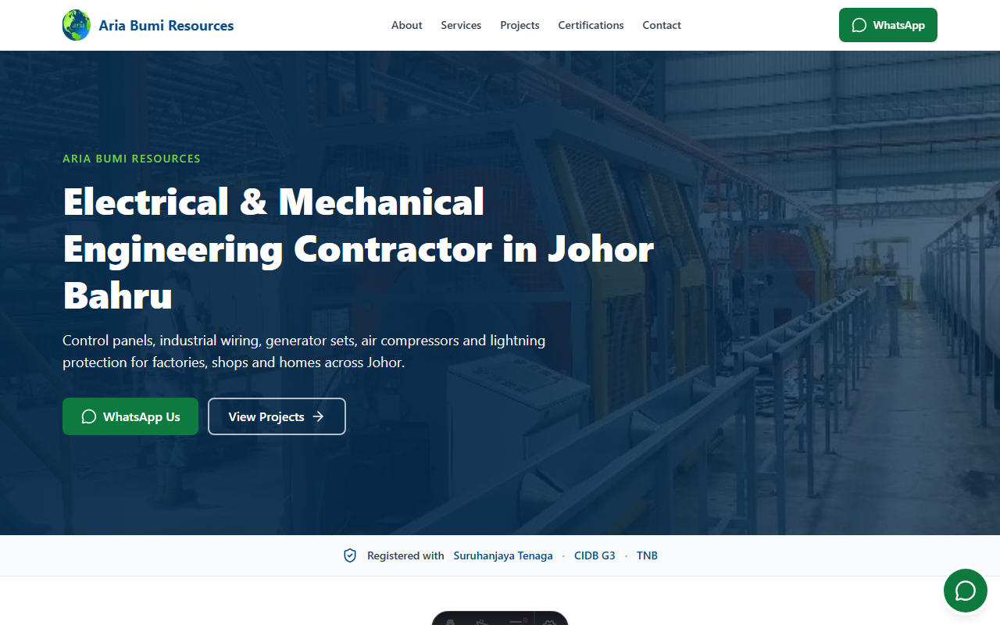

# Aria Bumi Resources

Company website for Aria Bumi Resources, an electrical and mechanical engineering contractor in Johor Bahru. It is built mobile-first for credibility (registrations, team, projects) and for leads (WhatsApp, call, enquiry form).

**Live site:** https://aria-bumi-website.pages.dev



## Features

- **Project filter:** filter the projects grid by category with a small vanilla script. Without JavaScript every project is simply shown.
- **Lightbox:** gallery images open in a native `<dialog>` viewer with keyboard support.
- **Before/after:** images named `-before` / `-after` render as a comparison. Collage images are never cropped.
- **Contact form:** Web3Forms with a honeypot field and progressive enhancement. It works as a plain POST without JavaScript.
- **Click-to-load map:** nothing loads from Google until the visitor asks for the map.
- **SEO:** unique titles and descriptions, canonical and Open Graph tags, `Electrician` JSON-LD with opening hours, breadcrumb JSON-LD, sitemap and `robots.txt`.
- **Build-time warning** when the ST registration is close to expiry.
- **Bahasa Malaysia ready:** all UI strings live in `src/i18n/en.ts`.

### Lighthouse (mobile)

| Page | Performance | Accessibility | Best Practices | SEO |
|---|---|---|---|---|
| Home | 99 | 100 | 100 | 100 |
| Projects | 100 | 100 | 100 | 100 |
| Project detail | 100 | 100 | 96 | 100 |
| Contact | 100 | 100 | 100 | 100 |

Single runs with Lighthouse 13; expect small variation. The 96 on the project detail page comes from a low-resolution collage shown at its native size. A higher-resolution original photo would clear it.

## Tech stack

- [Astro](https://astro.build) (static output) with content collections
- [Tailwind CSS](https://tailwindcss.com) 4
- `astro:assets` for image resizing and WebP
- [lucide-static](https://lucide.dev) icons
- [Web3Forms](https://web3forms.com) for the contact form
- Hosted on Cloudflare Pages

## Project structure

```
public/            robots.txt, _redirects (/qr tracking link)
src/
  assets/          logo, hero, project photos, certificates
  components/      Header, Footer, Hero, Gallery, Lightbox, ContactForm, ...
  content/projects/  one Markdown file per project
  data/            company.ts (single source of truth), categories, hero
  i18n/            en.ts (all UI strings)
  layouts/         Base.astro (SEO, JSON-LD, shell)
  lib/             gallery helpers, certificate expiry check
  pages/           index, about, services, projects, certifications, contact
  styles/          global.css (Tailwind theme tokens)
docs/              README screenshot
```

Company facts (phones, address, hours, certificates, team) are edited in `src/data/company.ts`, never in components.

## Run locally

Requires Node 22.23.4 or newer (`.node-version` pins 24).

```bash
npm install
cp .env.example .env   # then set PUBLIC_WEB3FORMS_KEY
npm run dev
```

On Windows PowerShell use `Copy-Item .env.example .env`. The site runs at http://localhost:4321.

Other commands: `npm run build` creates the static site in `dist/`, and `npm run preview` serves it.

## Deploy (Cloudflare Pages)

| Setting | Value |
|---|---|
| Framework preset | Astro |
| Build command | `npm run build` |
| Build output directory | `dist` |
| Node version | from `.node-version` (24) |
| Environment variable | `PUBLIC_WEB3FORMS_KEY` (Production and Preview) |

The `site` URL in `astro.config.mjs` drives canonical links, Open Graph URLs, JSON-LD and the sitemap. It must match the Pages project name.

## Add a project

Create a Markdown file in `src/content/projects/`, for example `my-project.md`, and put its photos in `src/assets/projects/my-project/`:

```md
---
title: "Generator Set Installation"
category: power        # control-systems | power | mechanical | hvac | earthing-lightning | security
order: 11
client: ""             # optional
location: "Pasir Gudang, Johor"
year: 2026             # or null
featured: false
cover: ../../assets/projects/my-project/my-project-01.jpg
images:
  - ../../assets/projects/my-project/my-project-01.jpg
  - ../../assets/projects/my-project/my-project-02.jpg
---

A short description of the work.
```

Empty fields are hidden on the page. Filename conventions: `-collage` images are shown uncropped at full width, and `-before` / `-after` images render as a before/after comparison.

## Privacy

Personal competency certificates, SSM and licence scans, tax and bank details, and university certificates must never be added to the site. Only the ST and CIDB company certificates are published, and qualifications are stated as text. See `CLAUDE.md`.
